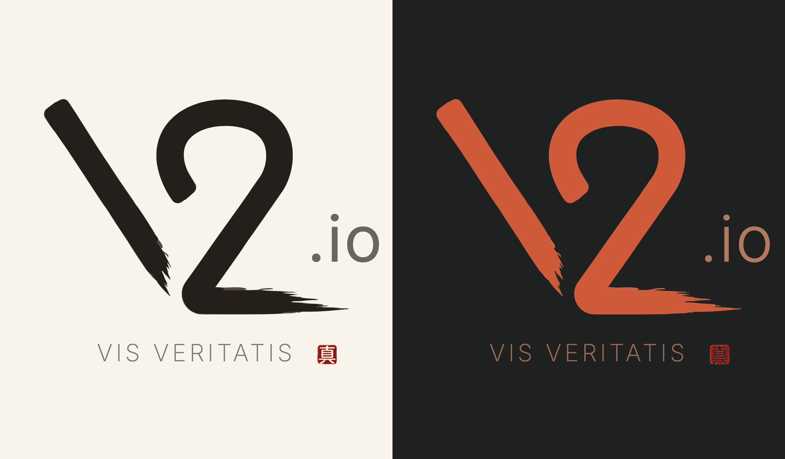

# v2.io brand assets

The v2 mark is one of the UDON mark's own brush strokes drawn along the skeleton of Joseph's earlier geometric v2 logo, so it shares UDON's brush (its clean start, dry-brush end and stroke width) while keeping the old logo's idea: the 2's diagonal is the V's second arm.



| File | What |
|---|---|
| `v2-mark.svg` | the mark in sumi: a dense core `#241F1A` over the dry-brush edge `#3A3129` at 0.88 opacity, for light grounds |
| `v2-mark-vermilion.svg` | the mark in vermilion (core `#CF5A3A`, edge `#DB6D49`), for dark grounds |
| `v2-seal.svg` | the 真 (truth) seal in four reds, a trace of Gemini's rendering |
| `v2-mark-layout.json` | where `.io` goes and how big the words are, as fractions of the mark's box (written with the mark) |
| `specimen/lockup.html` | the lockup on washi and on slate |
| `specimen/lockup.png` | a screenshot of the specimen |
| `tools/v2brush.py` | the script that draws the mark |

## The lockup

The mark, with `.io` to the right of the 2's bowl, its baseline level with the middle of the diagonal; beneath, VIS VERITATIS centred on the mark with the seal tucked onto its end.

- `.io` is Inter at 0.295 of the mark's height (as UDON is to its bowl), tracked 0.025em. On washi it is Inter 400 in ink `#2D2A26` at 70%, so a little paper shows through; on slate it is Inter 300 in a dull terracotta, `#C98A69` at 85%, so it doesn't compete with the vermilion mark.
- VIS VERITATIS is Inter 200 at 0.11 of the mark's height, tracked 0.14em, in the subtitle colour at 72% (`#4E4842` on washi, `#C98A69` on slate), set below the mark by 7% of its width.
- The seal sits on the motto's baseline after an extra space (0.9em), 0.86em tall, hanging off the end so that the motto stays centred. One per view.
- On washi the mark is sumi; on slate it is vermilion.

`v2-mark-layout.json` gives `.io`'s place and both type sizes as fractions of the mark's box, so the lockup follows the mark if it is regenerated.

## How the mark is made

`tools/v2brush.py` does it in four steps; its header has the detail.

1. **The brush.** The UDON mark (`~/src/arch/firmatum/udon/ux/brand/udon-mark.svg`) is rasterised layer by layer and split into its four strokes. The second from the left, the straight one with a clean start and a split dry-brush end, is the brush.
2. **The skeleton.** The 2's centreline runs midway between the outer and inner Bézier edges of the 2 in `v2-io-jaw.svg` (the earlier geometric logo), paired at equal fractions of their length, then down the middle of the diagonal, round a small fillet, and along the base. The V's centreline starts at the middle of the top of the old V stroke and is aimed into the 2's corner, so that the V's taper lands where the 2's diagonal meets the base.
3. **The mapping.** Each pixel near a path finds its nearest point on the path: how far along the path that is picks a row of the brush, and how far across picks a column. The brush's start and end map unstretched; only its middle stretches to the length of the path. The brush is mirrored so that, as in the UDON bowl, the solid edge is on the outside and the bristles break up on the inside: along the top of the 2's base, along the inner edge of the V.
4. **The trace.** potrace traces the core and the edge separately, and the two are written as one SVG in each ink.

The stroke is 12.4% of the mark's height (UDON's is 7.6%: the v2 has fewer strokes, so each carries more weight). To regenerate, or to try another weight:

```bash
python3 brand/tools/v2brush.py --ratio 0.13
```

It needs numpy, scipy, Pillow, `potrace` and `rsvg-convert`, and writes `v2-mark.svg`, `v2-mark-vermilion.svg` and `v2-mark-layout.json` here.

## Explorations

The other routes (the Gemini renderings and their traces, the Momo Trust ligatures, the flat geometric drafts, the earlier brush passes) are in `../.archive/brand-explorations-2026-10-29/`, with a README saying what each one is and why it was set aside.
